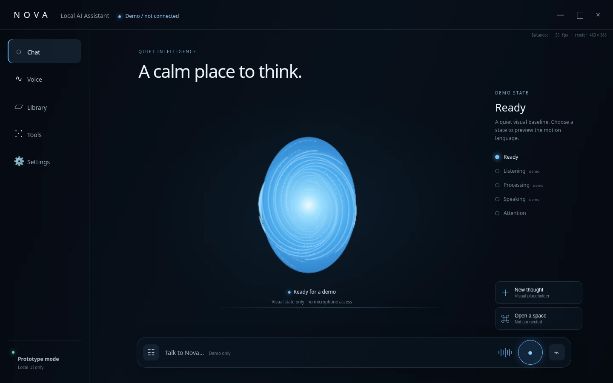
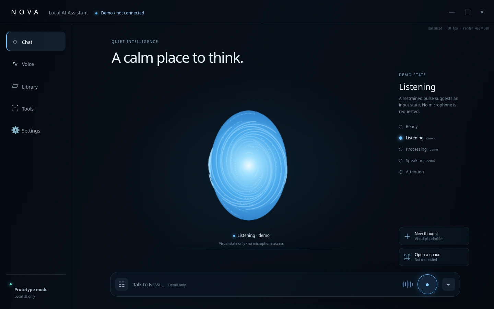
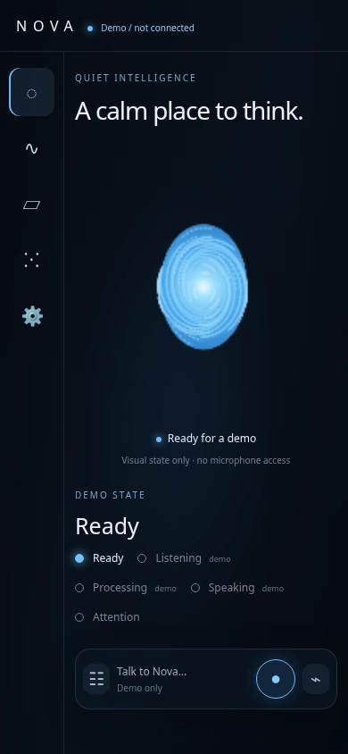

# Soul UI v0.2 — 検証画像

画像をタップすると個別に表示できます。画像ページの Raw / Download raw file から保存できます。WebPはSafariで閲覧可能で、品質95で圧縮しています（元UIのVFX設定は変更なし）。

## PC Ready — 1440×900

## PC Listening — 1440×900

## iPhone相当 Ready — 390×844

## 検証結果

- Playwright + Chromium 154。実機Safariではなくモバイルエミュレーション。
- 1440×900、390×844、375×812、320×568で全5状態（20ケース）を検証。
- スマホで見出し、Canvas、説明文、状態パネル、操作バーの非重複と横スクロールなしを座標で確認。小画面は縦スクロール可能。
- 1440×900のReady / Listeningは同一アニメーション時刻でv0.1と画素一致。
- Soul Renderer、状態切替JS、品質設定は変更なし。Canvas 2D描画を確認。
- JavaScript例外・Canvas描画エラーなし。favicon.icoの404、および検証時のピクセル読取に伴う性能警告のみ。
- スマホ画像はページ全体を撮影。スクリーンショットは静止画で、元UIのアニメーションは維持。
