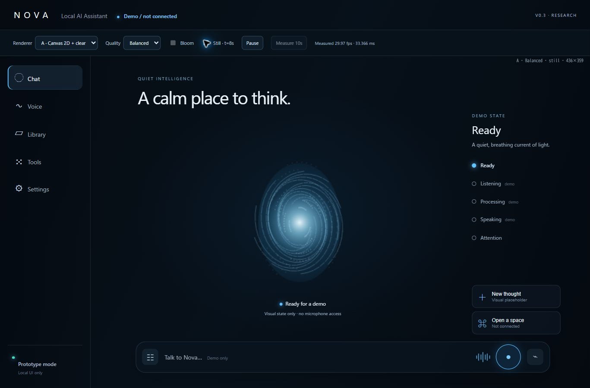
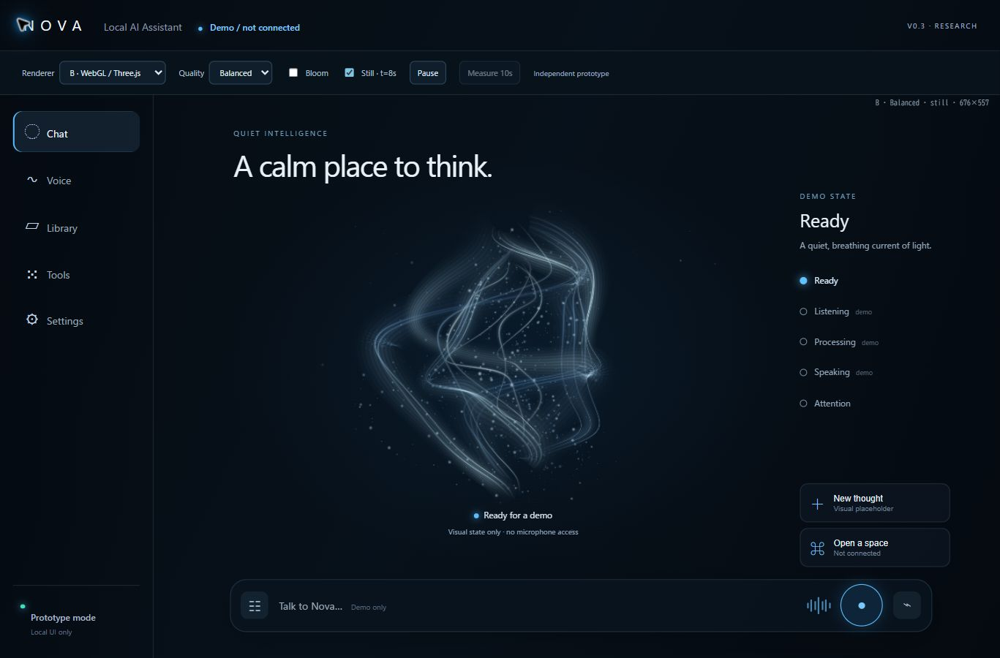
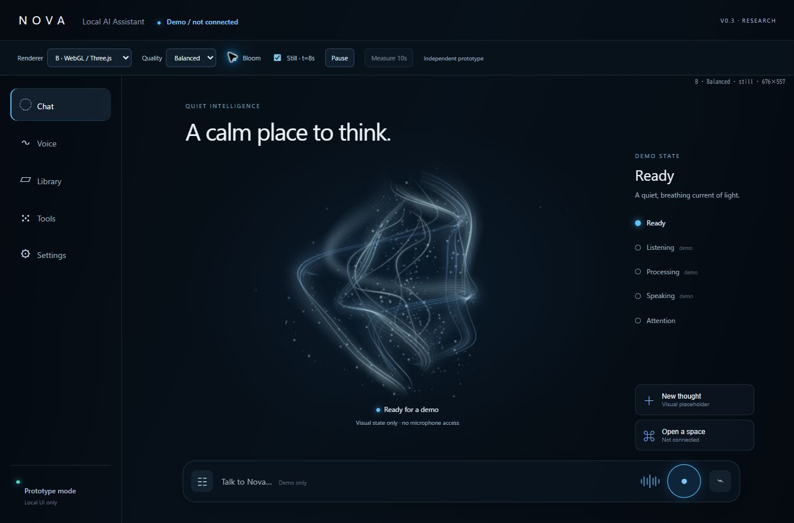
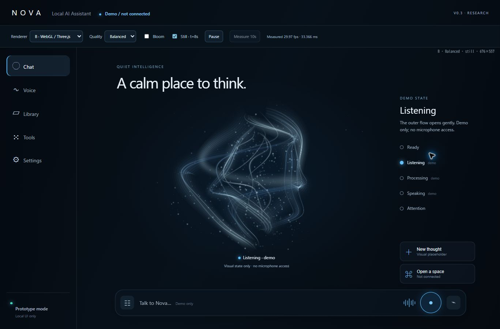
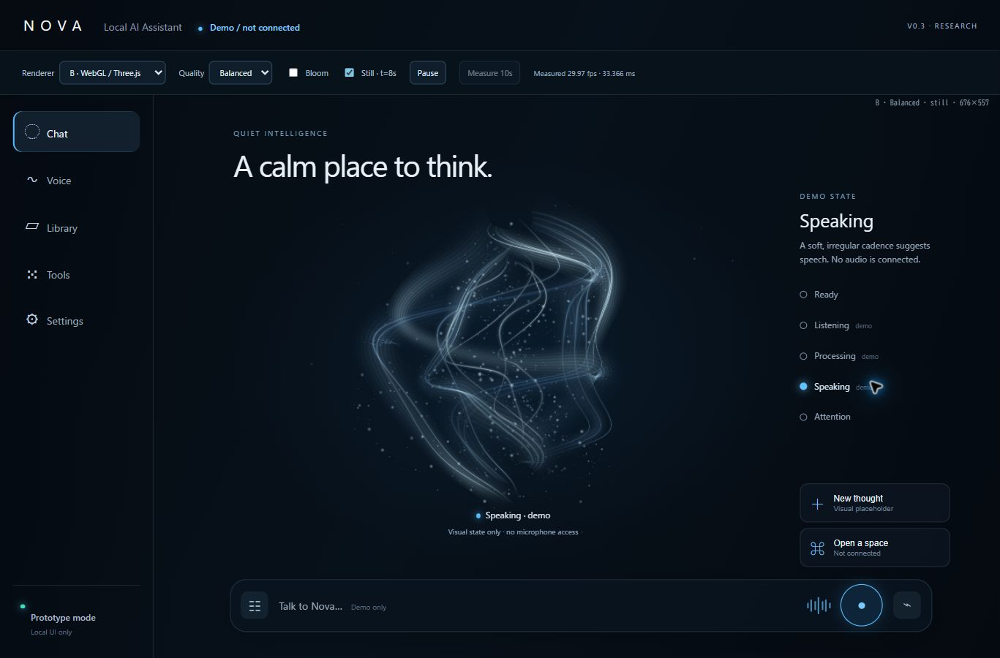
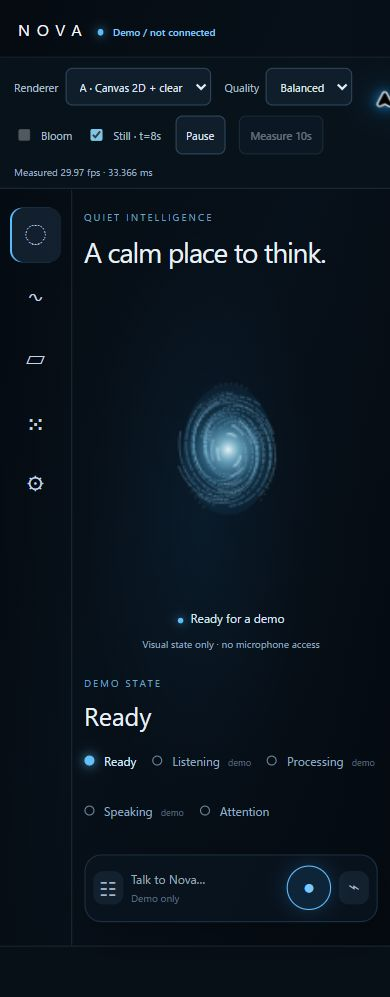
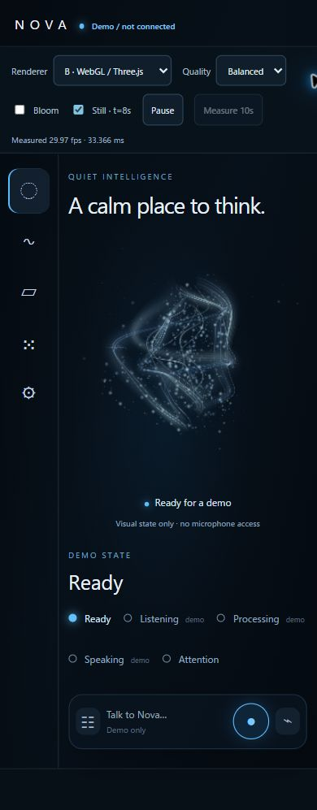
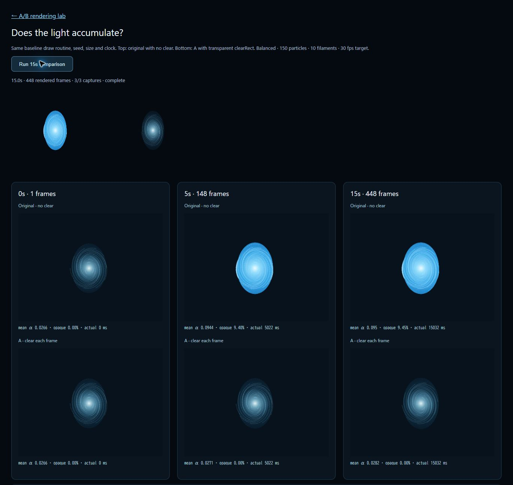

# Soul v0.3 — 比較ギャラリー

Windows Chromeで実際に描画した画像です。正式v0.2は未変更。Bは独立プロトタイプで、最終採用前の比較資料です。

[結果・実測・残課題](../../../experiments/v0.3/RESULTS.md) ／ [起動方法](../../../experiments/v0.3/README.md)

このREADMEと各画像は通常のGitHub URLで開けます。iPhone Safariでは画像名をタップして拡大できます。以下の「iPhone相当」はWindowsで390×844 CSS pxにしたレイアウト検証であり、実機Safariの描画・性能試験ではありません。

## PC — A / B

### A: Canvas 2D・フレーム消去あり

[画像を開く](a-pc-ready.jpg)

### B: Three.js / WebGL2・Bloom OFF（推奨候補）

[画像を開く](b-pc-ready-bloom-off.jpg)

### B: Bloom ON

[画像を開く](b-pc-ready-bloom-on.jpg)

いずれもBalanced、Ready、固定時刻8秒。Bloomの効果は控えめです。

## Bの状態

| Listening | Speaking |
| --- | --- |
|  |  |

[Processing](b-pc-processing.jpg) ／ [Attention](b-pc-attention.jpg)

状態差はアニメーションも含めて設計しています。静止画だけでは特にListening/Speakingの差が小さく、追加評価が必要です。

## iPhone相当 — 縦スクロール全体

| A Ready | B Ready |
| --- | --- |
|  |  |

## A — 光は蓄積していたか

上段が元の消去なし、下段が修正A。初回・約5秒・約15秒を同じ時計で取得。

[比較画像を開く](a-accumulation-comparison.jpg)

| 時刻 | 元（透過WebP） | 修正A（透過WebP） |
| --- | --- | --- |
| 0秒 | [元0秒](a-original-0s.webp) | [A 0秒](a-corrected-0s.webp) |
| 5秒 | [元5秒](a-original-5s.webp) | [A 5秒](a-corrected-5s.webp) |
| 15秒 | [元15秒](a-original-15s.webp) | [A 15秒](a-corrected-15s.webp) |

透過WebPを白背景で開くと見え方が変わるため、まず上の暗い背景付き比較画像を見てください。

## 6秒の参考動画

- [A Ready MP4を開く](a-ready.mp4) — 428×358、6.004秒、約57 KiB。
- [B Ready MP4を開く](b-ready.mp4) — 666×556、5.969秒、約1001 KiB。
- GitHubのファイル画面で再生できない場合: [Aの直接MP4](https://raw.githubusercontent.com/KuraMasajapan/AI-Harness/development/projects/JARVIS_Soul_UI/docs/previews/v0.3/a-ready.mp4) ／ [Bの直接MP4](https://raw.githubusercontent.com/KuraMasajapan/AI-Harness/development/projects/JARVIS_Soul_UI/docs/previews/v0.3/b-ready.mp4)。ブラウザによってはダウンロードになります。

H.264/AVC、音声なし。Soul領域のみ、暗背景へ合成済み。Windows Chromeでデコードを確認しBは再生も目視確認。実機iPhoneでの再生は未確認です。
